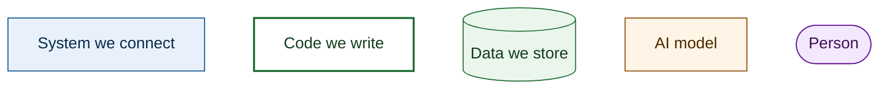
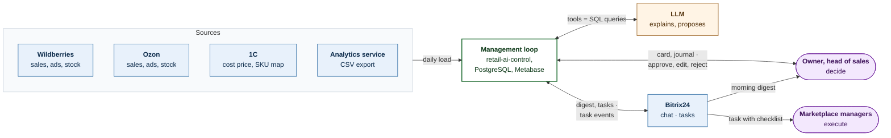
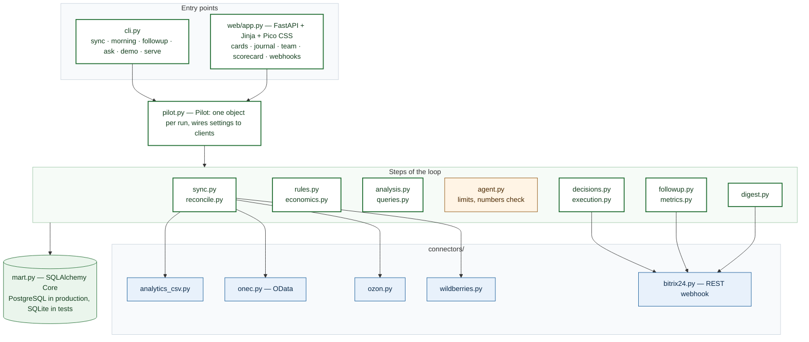
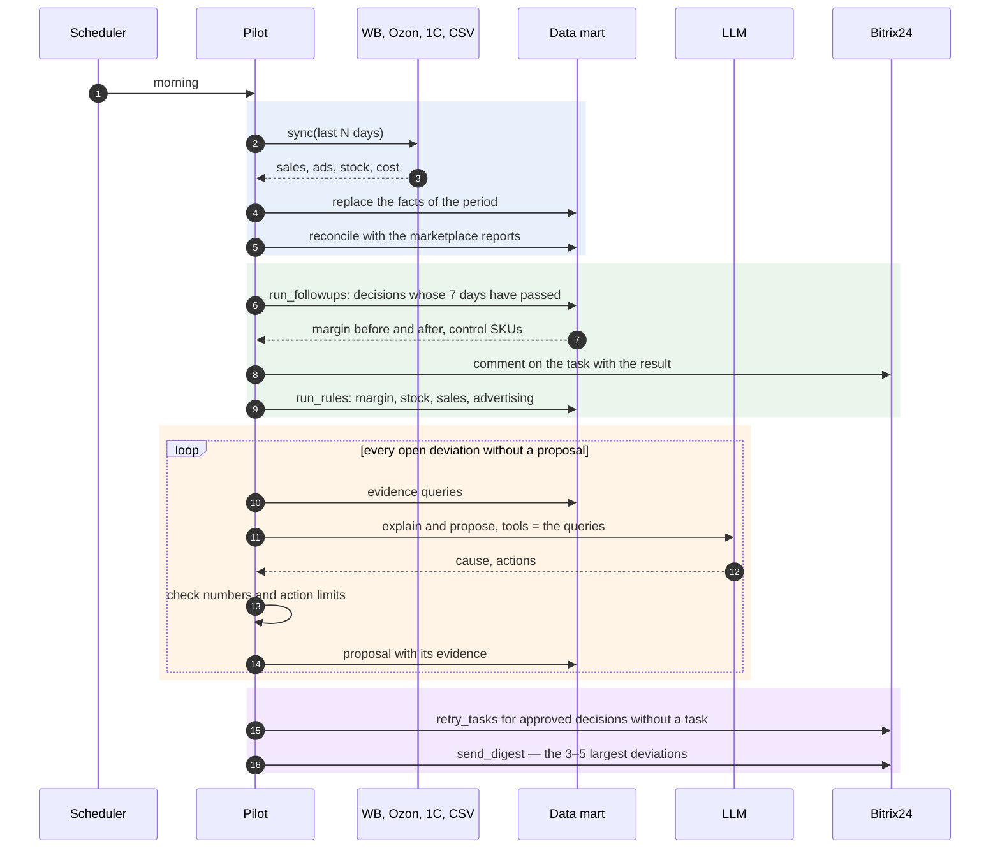
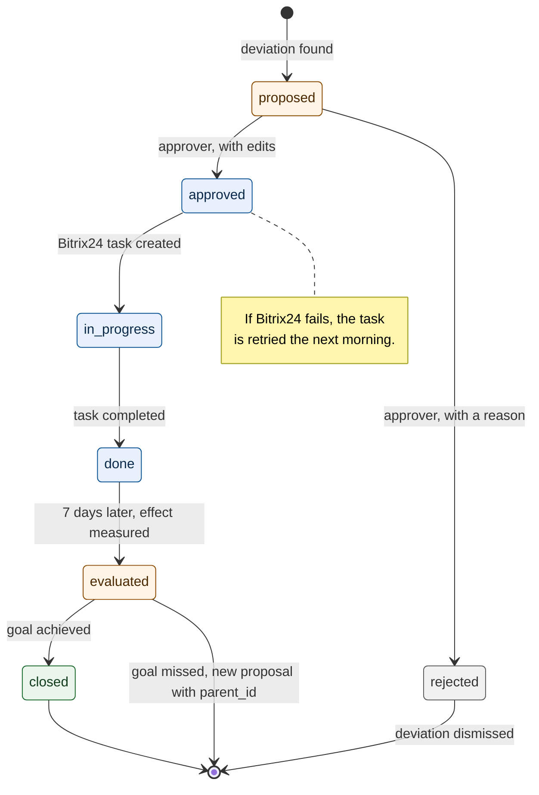
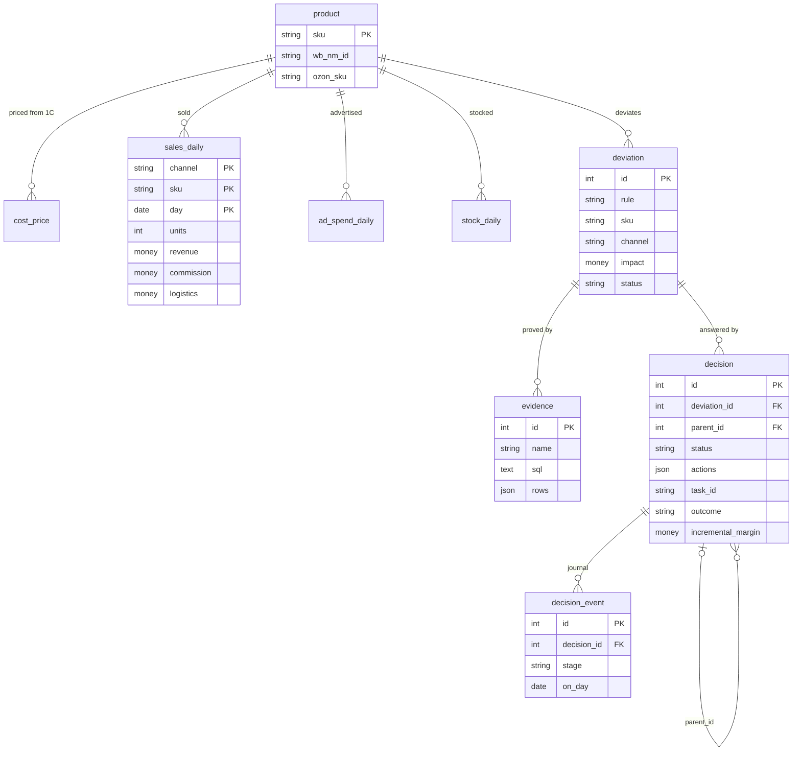
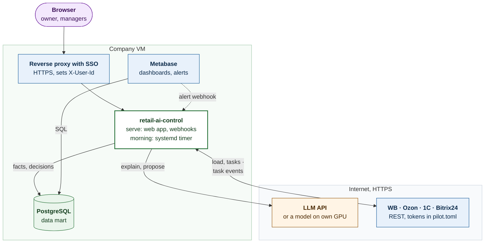

# Architecture

This page shows how the pilot from the [concept](../concept/README.md) is
built: what we buy, what we write, how one morning runs and how a decision
moves from a proposal to a measured effect. The requirements are the
[Gherkin features](https://github.com/konard/marketplace-retail-ai-control/tree/main/features);
every scenario is an automated test.

The diagrams use one colour per kind of element:

## 1. Context: the loop around the people who decide

The company keeps working in 1C and Bitrix24. The pilot adds one data mart,
alerts and an agent that turns a deviation into a proposal; people approve
and execute, and the system measures the result. Here the whole loop is one
box; the next section opens it.

## 2. Containers and modules

One Python package, `retail_ai_control`, runs as a scheduled CLI and as a web
app. Both use the same `Pilot` object, so a test drives exactly the code that
runs in production; external systems are replaced at the HTTP level with
`httpx.MockTransport`.

| Layer | Ready library or service | Our code |
|---|---|---|
| HTTP clients | [httpx](https://www.python-httpx.org/) | five thin connectors, one file each |
| Storage | [SQLAlchemy Core](https://docs.sqlalchemy.org/en/20/core/), PostgreSQL | table definitions and the unit-economics view |
| Dashboards and alerts | [Metabase](https://www.metabase.com/docs/latest/questions/alerts) | 10–15 saved questions |
| AI | any OpenAI-compatible API through the [openai](https://github.com/openai/openai-python) client: GigaChat, YandexGPT or a local model | tools, prompt, checks of numbers and limits |
| Web | [FastAPI](https://fastapi.tiangolo.com/), [Jinja](https://jinja.palletsprojects.com/), [Pico CSS](https://picocss.com/) | 6 server-rendered pages, no JavaScript |
| Tasks and chat | Bitrix24 REST: `tasks.task.add`, `im.message.add` | the task template |
| Specification | [pytest-bdd](https://pytest-bdd.readthedocs.io/) | step definitions in `tests/bdd/` |

## 3. One morning, step by step

`retail-ai-control morning` runs once a day from cron or a systemd timer.
Every step is idempotent: a failed source or a failed task is retried on the
next run and never stops the other steps.

If the model is not configured, unavailable or returns a number that is not
in the evidence, the proposal is built by the rules and labelled
«Расчёт по правилам»; the loop never waits for the AI.

## 4. The life of a decision

A decision is closed only when the follow-up shows that the goal was
achieved. Otherwise it stays in the journal as evaluated, the deviation is
reopened, and a new proposal links back to it with `parent_id`.

| Status | Shown as | Who moves it |
|---|---|---|
| `proposed` | Ждёт решения | the agent or the rules |
| `approved` | Утверждено | an approver in the web app |
| `rejected` | Отклонено | an approver, a reason is required |
| `in progress` | В работе | the system, when the task is created |
| `done` | Выполнено, ждём эффект | Bitrix24 task event |
| `evaluated` | Цель не достигнута | follow-up, goal missed or partly achieved |
| `closed` | Цель достигнута | follow-up, goal achieved |

## 5. Data mart

All figures come from SQL over these tables; the AI reads them through the
same queries and cannot write.

Support tables: `reconciliation` (computed vs reported revenue per channel and
week), `unmapped` (marketplace items without a 1C SKU) and `sync_run` (one row
per source and run). The view `unit_economics` adds the cost of goods and the
margin per SKU × channel × day.

## 6. Deployment

The proposed deployment for the pilot: one small virtual machine inside the
company network is enough for 30–50 SKUs. The tokens of the marketplaces and
Bitrix24 live only in the settings file on this machine.

The settings are one TOML file (`pilot.toml`): tokens, the list of approvers,
the manager of each channel, margin plans and action limits. Run
`retail-ai-control demo` and `retail-ai-control serve --user 1` to see every
screen on demo data without connecting any system.
