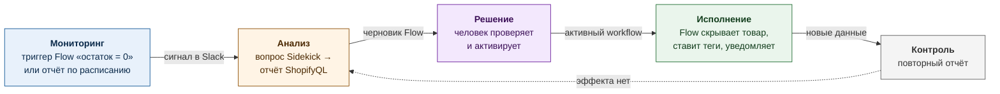
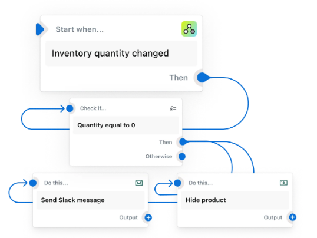
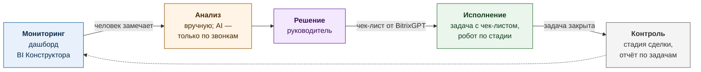
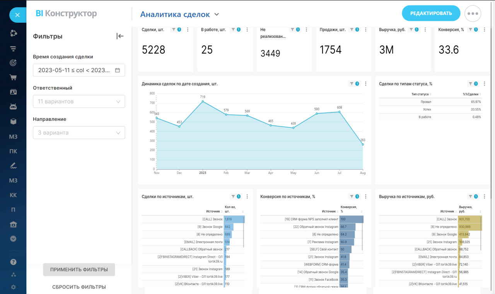

# Концепция: AI-контур управления для продавца на Wildberries и Ozon

Цель — один замкнутый контур «мониторинг → анализ → решение → исполнение →
контроль» по продажам, прибыльности, расходам и работе команды поверх того, что
уже есть: 1С, Битрикс24, данные маркетплейсов и сторонней аналитики.
Проверка источников — в [приложении](sources.md) (не входит в 2 страницы).

## Часть 1. Два референсных примера

### Пример 1. Shopify Sidekick + Shopify Flow (кейс SNOCKS)

**Что делает и роль AI.** Sidekick — AI-ассистент в админке Shopify: отвечает
на вопросы о продажах отчётом ShopifyQL и по описанию собирает черновик Flow —
no-code автоматизации «триггер → условие → действие» (Slack, скрытие товара,
теги, расписание). Активирует её только человек ([changelog, 11.12.2025](https://changelog.shopify.com/posts/create-flow-automations-with-sidekick)).
В [кейсе SNOCKS](https://www.shopify.com/case-studies/snocks-sidekick) четыре
отдела сами получают отчёты (≈30 минут → секунды), а руководитель e-commerce
проверяет собранные Sidekick автоматизации и выпускает их в работу.

*Визуал: workflow Flow со [страницы продукта](https://www.shopify.com/flow).*

- **Что взять:** AI готовит черновик действия, а не действует сам; человек
  утверждает; исполняет автоматизация. Отделы сами задают вопросы к данным.
- **Ограничения:** только данные Shopify (нет WB, Ozon, 1С), зарубежное облако —
  как платформа не подходит. В независимом тесте агентства tante-e ([приложение](sources.md))
  Flow собирались надёжно, а KPI-анализы «слишком ненадёжны». Вывод: числа
  считает витрина данных, AI их объясняет и предлагает действия.
- **Источник знаний:** документация и кейс вендора, независимый тест. Личного
  опыта внедрения нет.

### Пример 2. Битрикс24: BI Конструктор + BitrixGPT + роботы

**Что делает и роль AI.** [BI Конструктор](https://helpdesk.bitrix24.ru/open/18897300/)
— отчёты на Apache Superset внутри Битрикс24; кроме CRM и задач подключает
[внешние MySQL, PostgreSQL, ClickHouse](https://helpdesk.bitrix24.ru/open/28344102/),
базы 1С и CSV. [Роботы](https://helpdesk.bitrix24.ru/open/17784680/) ставят
задачи и следят за сроками, триггеры двигают сделку после закрытия задачи.
[BitrixGPT](https://www.bitrix24.ru/features/ai/) заполняет карточку CRM по
звонку, формирует задачу «с пошаговым чек-листом», через MCP связан с 1С.
AI-анализа цифр в BI вендор не заявляет.

*Визуал: скриншот из [справки Битрикс24](https://helpdesk.bitrix24.ru/open/18897300/).*

- **Что взять:** задачи, согласования и сроки — там, где команда уже работает;
  готовый Superset читает нашу PostgreSQL; задачи извне — REST-метод [`tasks.task.add`](https://apidocs.bitrix24.ru/api-reference/tasks/tasks-task-add.html).
- **Ограничения:** нет коннекторов WB и Ozon и юнит-экономики SKU; объём данных
  ограничен тарифом по каждому источнику; отклонения не находятся и не
  объясняются автоматически — между мониторингом и решением только человек.
- **Источник знаний:** справка и страницы вендора. Подтверждённого внедрения и
  личного опыта нет.

## Часть 2. Предложение для компании

Принцип: покупаем и подключаем; пишем только тонкий слой на Python —
коннекторы, витрину, правила отклонений и AI-агента.

**Купить или собрать.**

| Слой | Готовое | Подключить и настроить |
|---|---|---|
| Учёт, CRM, задачи | 1С, Битрикс24: задачи, роботы, чат, BitrixGPT | шаблон задачи-решения, роботы сроков |
| Данные | API WB, Ozon, 1С, Битрикс24; PostgreSQL | коннекторы, сопоставление артикулов 1С ↔ WB ↔ Ozon, юнит-экономика SKU |
| BI и сигналы | [Metabase](https://www.metabase.com/docs/latest/questions/alerts) на своём сервере (алерты в webhook) или BI Конструктор поверх той же БД | 10–15 метрик, правила отклонений на SQL |
| AI | LLM по API (GigaChat, YandexGPT) или открытая модель на своём сервере | 5–7 инструментов-запросов к витрине, промпт «объясни и предложи» |

Не строим: свой BI, трекер задач, обучение модели и свой интерфейс.

**Как пользуются.** *Собственник и руководитель* утром получают в чате
Битрикс24 дайджест: 3–5 главных отклонений (продажи, маржа, расходы, просрочки)
со ссылкой на дашборд и предложением «утвердить / исправить / отклонить»;
задают вопросы обычным языком («почему маржа Ozon упала на 3 п.п.?») и раз в
неделю смотрят журнал решений и их эффект. *Сотрудники* (менеджеры маркетплейсов,
закупка, маркетинг, финансы) получают обычные задачи в Битрикс24 с цифрами,
причиной, чек-листом, сроком и критерием успеха. Работу команды видно по срокам
и доле решений с достигнутым эффектом.

**Сквозной сценарий** (цифры условные).

1. **Обнаружение.** Правило «маржа SKU после комиссии, логистики и рекламы ниже
   плана 3 дня подряд»: артикул на Ozon — 4% при плане 15%. Metabase шлёт webhook.
2. **Предложение.** Агент раскладывает маржу по статьям и сравнивает периоды и
   каналы: доля рекламы выросла с 9% до 21% после повышения ставки, цена на 12%
   ниже WB. Предлагает вернуть ставку и поднять цену на 5%; цель — маржа ≥12%
   при падении продаж ≤10%. У каждого числа есть ссылка на SQL-запрос.
3. **Утверждение.** Руководитель в Битрикс24 утверждает с правкой: цена +3%.
4. **Исполнение.** Агент ставит задачу менеджеру Ozon с чек-листом и критерием;
   ставку и цену в кабинете меняет человек, робот напоминает о сроке.
5. **Проверка.** Через 7 дней агент сравнивает с периодом до изменения и с
   контрольными SKU и пишет в задачу и дайджест: «маржа 11,8%, продажи −6%, цель
   достигнута частично». Руководитель закрывает решение или просит следующий
   шаг; всё остаётся в журнале решений.

**Пилот (6–8 недель).** Один канал, себестоимость из 1С, задачи в Битрикс24;
30–50 SKU с наибольшей выручкой, 3–5 правил по марже и остаткам; собственник и
2–3 менеджера.

- **Что проверяем:** (1) можно ли достоверно собрать юнит-экономику SKU из API
  и 1С; (2) полезны ли объяснения и предложения AI; (3) замыкается ли контур
  решение → задача → проверенный эффект.
- **Метрика:** прирост маржинальной прибыли пилотных SKU против контрольной
  группы за 4 недели покрывает затраты пилота. Дополнительно: расхождение с
  финансовым отчётом маркетплейса ≤2%; ≥60% предложений утверждены без
  существенных правок; от отклонения до выполненной задачи ≤2 рабочих дней
  (базовый уровень замеряем в первые 2 недели).
- **Главный риск:** качество данных — себестоимость в 1С, сопоставление
  артикулов, задержки и пересчёты отчётов маркетплейсов. Уверенное объяснение
  неверных цифр убьёт доверие. Снижаем: числа считает только SQL, первые 2
  недели — сверка без рекомендаций.
- **Открытые вопросы:** (1) можно ли отдавать данные внешнему LLM или нужна
  модель на своих серверах (есть ли GPU); (2) конфигурация 1С, опубликован ли
  OData, как ведутся себестоимость и соответствие артикулов; (3) Битрикс24 —
  облако или коробка, тариф; (4) какие сервисы аналитики остаются и есть ли у них
  API; (5) кто владеет метриками и утверждает изменения цен и рекламы; (6) можно
  ли позже исполнять решения автоматически через API маркетплейсов.
