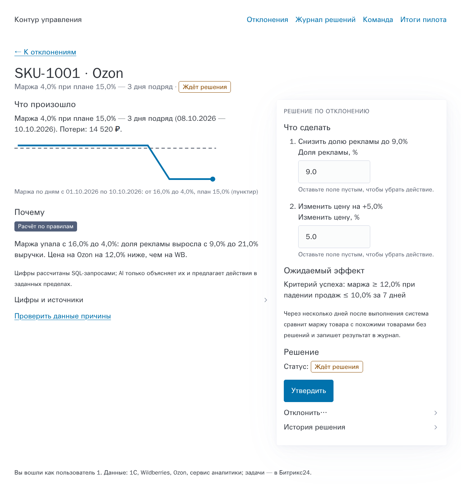
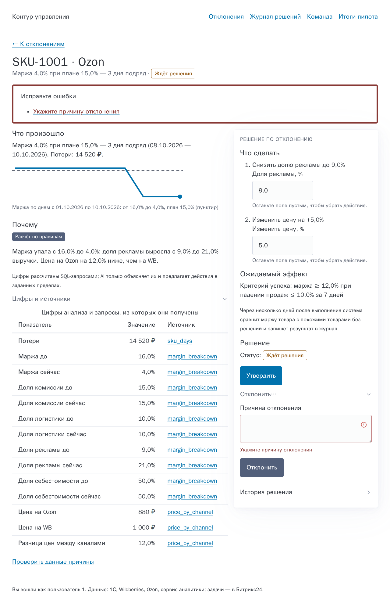
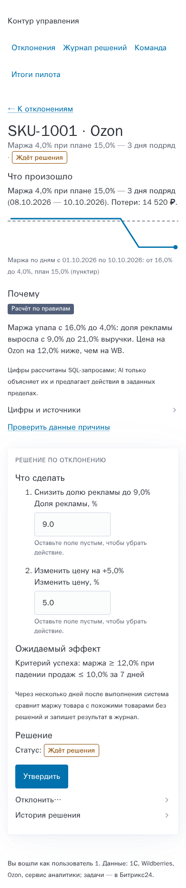
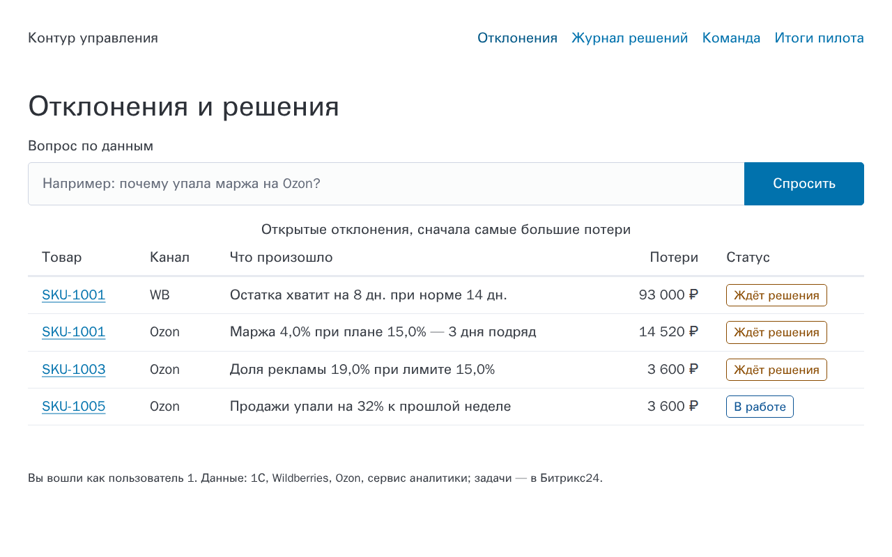
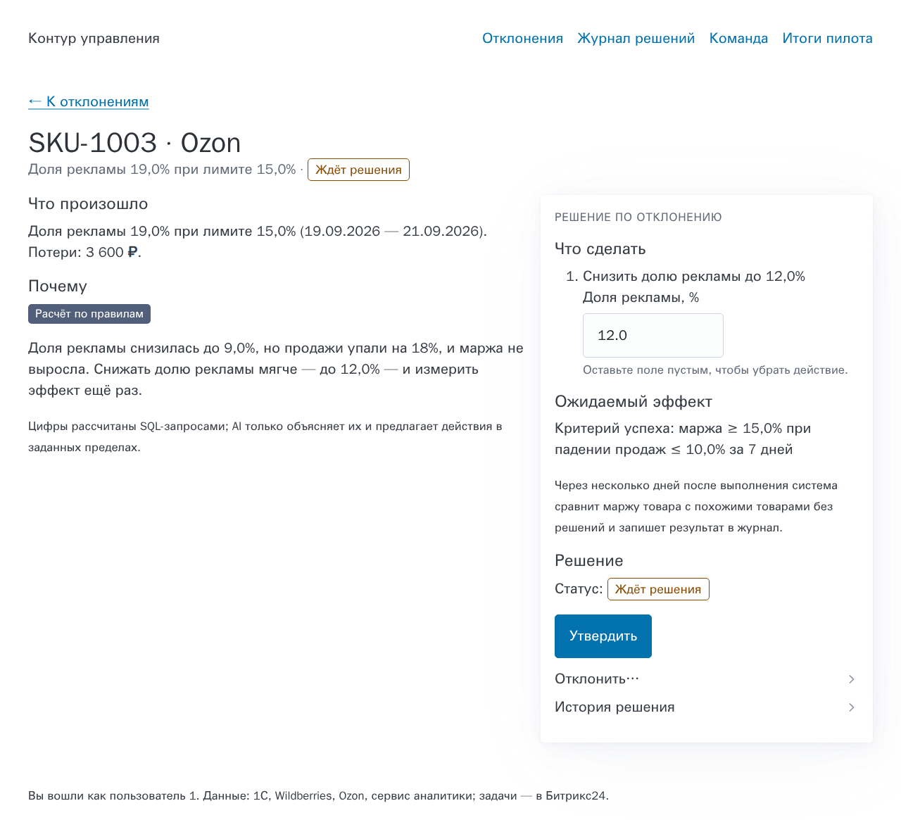
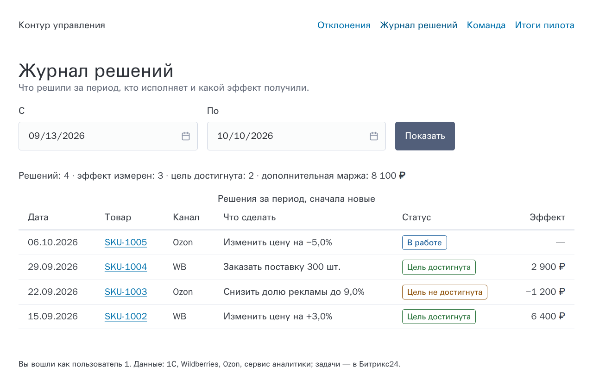
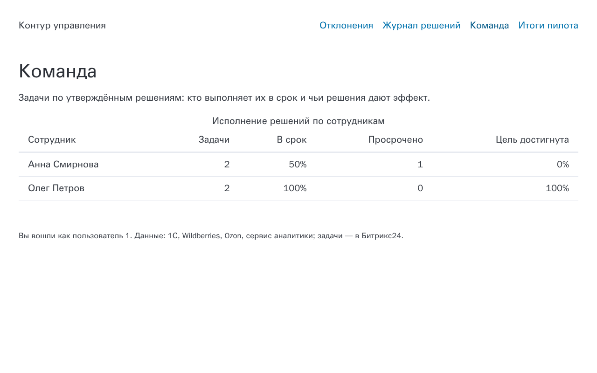
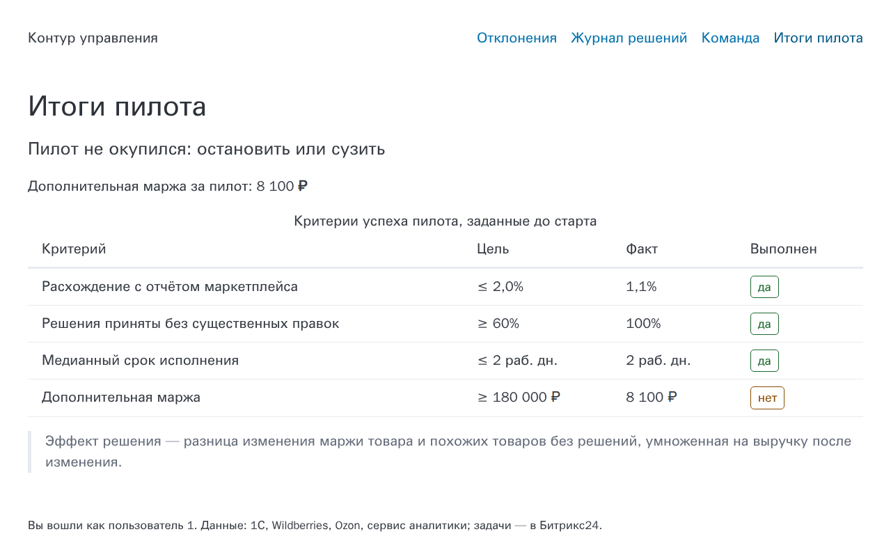

# UX guidelines for the decision screens

The screens serve one job: an owner or a manager sees what went wrong,
checks why, and decides in a minute, without trusting the AI blindly. We did
not invent rules for this; we follow the most widely used guidelines for
human-AI interaction, usability and accessibility, and we test each rule as a
scenario in [`features/14_user_interface.feature`](../../features/14_user_interface.feature)
and its neighbours.

## Sources

| Guideline | Why it applies here |
|---|---|
| [Microsoft HAX Guidelines for Human-AI Interaction](https://www.microsoft.com/en-us/haxtoolkit/ai-guidelines/) (Amershi et al., CHI 2019) — 18 guidelines | the AI proposes, a person decides |
| [Google People + AI Guidebook](https://pair.withgoogle.com/guidebook/): Explainability + Trust, Feedback + Control, Errors + Graceful Failure | how much to trust an AI explanation |
| [Nielsen Norman Group, 10 usability heuristics](https://www.nngroup.com/articles/ten-usability-heuristics/) | the general usability baseline |
| [WCAG 2.2](https://www.w3.org/TR/WCAG22/), level AA | accessibility, also required by public procurement in many countries |
| [GOV.UK Design System](https://design-system.service.gov.uk/): [error summary](https://design-system.service.gov.uk/components/error-summary/), [error message](https://design-system.service.gov.uk/components/error-message/), [details](https://design-system.service.gov.uk/components/details/) | tested form patterns for people who are not specialists |
| Ben Shneiderman, [*The Eyes Have It*](https://www.cs.umd.edu/~ben/papers/Shneiderman1996eyes.pdf) (1996): «overview first, zoom and filter, then details on demand» | the order of digest, list, card and evidence |
| [Pico CSS](https://picocss.com/) | semantic HTML gets readable, accessible styles without our own design system |

## The rules and where they are checked

### 1. Overview first, details on demand

The morning digest names the 3–5 largest deviations; the home page lists all
open ones by money at stake; the card explains one; the evidence page shows
the SQL and its rows. Each level links to the next one.

| Screen | Rule | Scenario |
|---|---|---|
| Home | sorted by impact, the SKU links to the card | 14 «The home page lists open deviations by impact» |
| Card | sections in the order a manager asks: what happened → why → what to do → expected effect → decision | 14 «The decision card answers the questions in the order a manager asks them» |
| Card | the approver's part is one panel; on a wide screen it stays next to the analysis | 14 «What the approver acts on stays together in one decision panel» |
| Evidence | every figure links to its query (HAX G11, PAIR) | 14 «Every figure can be traced to its data», 05 «Every figure has evidence that links to its SQL query» |
| Journal | one period, newest first, with a summary line | 15 «By default the journal shows the last four weeks», «The owner reviews one week» |

### 2. AI output is labelled and its limits are stated

| Guideline | How | Scenario |
|---|---|---|
| HAX G1 «Make clear what the system can do» | under the explanation: «Цифры рассчитаны SQL-запросами; AI только объясняет их и предлагает действия в заданных пределах» | 14 «The card says who wrote the explanation» |
| HAX G2 «Make clear how well the system can do what it can do» | the label «Сгенерировано AI» or «Расчёт по правилам» on every explanation | 14, 05 «The AI model is unavailable» |
| HAX G11 «Make clear why the system did what it did» | the cause with its numbers and a link to the data | 05 «The margin drop is decomposed by cost item» |
| PAIR, Errors + Graceful Failure | an AI answer with a figure that is not in the data is never shown; the rules answer instead | 05 «An AI explanation with a figure that is not in the evidence is rejected», 06 «An answer with figures that the data does not back is not shown» |
| HAX G10 «Scope services when in doubt» | the AI may propose only the actions and the ranges from the settings | 05 «An AI action outside the allowed limits is rejected» |

### 3. The user stays in control

| Guideline | How | Scenario |
|---|---|---|
| HAX G9 «Support efficient correction», Nielsen 3 «User control and freedom» | every proposed value is an editable field; an empty field removes the action | 14 «The approver can edit the proposed values before approving», 08 «The approver changes a value before approving» |
| HAX G8 «Support efficient dismissal» | «Отклонить…» is always one click away, the reason field opens on demand (GOV.UK details) | 14 «What the approver acts on stays together in one decision panel» |
| HAX G16 «Convey the consequences of user actions» | the panel states the success criterion and when the effect is measured; the task repeats the criterion | 09 «The task carries the actions, the deadline and the success criterion», 10 «A partial result is posted to the task and starts a next step» |
| Nielsen 1 «Visibility of system status» | every decision shows its status as a word: Ждёт решения, В работе, Цель достигнута, Цель не достигнута | 14 «Accessibility basics on every page», 15 |
| Nielsen 5 «Error prevention» | only approvers see the buttons; others see why | 14 «A user who is not an approver sees why they cannot decide», 08 |

### 4. Errors are easy to recover from

A rejection without a reason, an empty question or a period whose start is
after its end shows the error twice, as GOV.UK does: a summary at the top
that links to the field, and the message next to the field (WCAG 3.3.1 Error identification, 3.3.2 Labels or instructions;
Nielsen 9).

| Screen | Scenario |
|---|---|
| Card, rejection | 14 «A rejection without a reason shows the error next to the field» |
| Journal, period | 15 «The start of the period is after its end» |
| Home, question | 06 «An empty question is explained next to the field» |

### 5. Accessible to everyone (WCAG 2.2 AA)

Checked on every page by 14 «Accessibility basics on every page»:

- 3.1.1 Language of page: `lang="ru"`.
- 1.3.1 Info and relationships, 4.1.2 Name, role, value: every field has a
  label; tables have captions and header cells with `scope`.
- 1.4.1 Use of colour: every status is a word; the colour only repeats it.
- 2.4.2 Page titled, 1.3.1: one `main` landmark and one `h1`.
- 1.1.1 Non-text content: the sparkline has a text alternative with the
  first, last and plan values (14 «The decision card answers the questions
  in the order a manager asks them»).

Done by construction and checked by review:

- 2.4.1 Bypass blocks: a «Перейти к содержанию» skip link.
- 1.4.3 Contrast: status colours are at least 4.5:1 on white.
- 1.4.10 Reflow: at 320–390 px the layout becomes one column and the menu
  wraps; nothing scrolls sideways.
- 2.4.7 Focus visible and keyboard use: plain links, buttons and
  `
`, no custom widgets, no JavaScript.

## Reuse instead of a design system

- **Pico CSS** styles semantic HTML: tables, forms, `details`, `article`. Our
  own CSS is about 40 lines in `src/retail_ai_control/web/static/app.css`:
  status badges, the two-column card, the error summary.
- **Server-rendered pages** with Jinja and plain HTML forms. They work
  without JavaScript, with a screen reader and behind any corporate proxy.
- **Bitrix24** stays the place where people work: the digest and the tasks
  come there, and the web app only holds what Bitrix24 cannot show — the
  card with evidence, the journal, the team and the pilot scorecard.
- **Metabase** draws the dashboards; we do not build charts except one
  sparkline on the card.

## Screens

The screenshots use the demo data: `retail-ai-control demo`, then
`retail-ai-control serve --user 1`. They are refreshed with
`experiments/screenshot_web.js`.

| Home: open deviations by impact | Re-proposal after a missed goal |
|---|---|
|  |  |

| Decision journal | Team |
|---|---|
|  |  |

